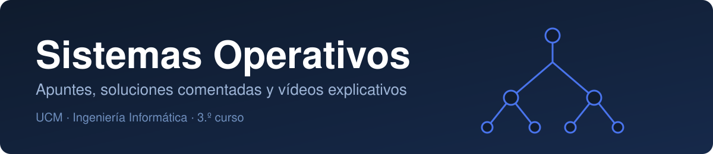

<p align="center"></p>

Material de la asignatura **Sistemas Operativos** (UCM): apuntes de C y terminal, soluciones comentadas de las prácticas y vídeos explicativos de cada ejercicio. Todo en rutas relativas: clona el repositorio y funciona igual en cualquier equipo.

## Contenido

| | Bloque | Qué hay | Estado |
|---|---|---|---|
|  | [Fundamentos](fundamentos/) | C, terminal, entorno de trabajo y herramientas | Completo |
|  | [P1 · Introducción](practicas/p1-introduccion/) | Runbook del ejercicio 1 | Parcial |
|  | [P2 · Ficheros con stdio](practicas/p2-ficheros-stdio/) | Corrección comentada y código | Completo |
|  | [P3 · Llamadas al sistema](practicas/p3-llamadas-al-sistema/) | `copy.c` con open/read/write | Parcial |
|  | [P4 · Procesos, hilos, señales y ficheros](practicas/p4-procesos-hilos-senales/) | Corrección, código y 5 vídeos | Completo |
|  | [P5 · Sincronización de hilos](practicas/p5-sincronizacion-hilos/) | Explicación, código y vídeo | Completo |

## Mapa por temas

| Tema | Dónde |
|---|---|
|  Punteros, memoria dinámica, structs | [fundamentos/c](fundamentos/c/) |
|  Redirecciones, pipes, permisos, scripts | [fundamentos/terminal](fundamentos/terminal/) |
|  gcc, make, gdb | [herramientas](fundamentos/herramientas-gcc-make-gdb.md) |
|  fork, exec, wait | [P4 · Ejercicio 1](practicas/p4-procesos-hilos-senales/) |
|  pthread, paso de argumentos | [P4 · Ejercicio 2](practicas/p4-procesos-hilos-senales/) |
|  alarm, kill, sigaction | [P4 · Ejercicio 3](practicas/p4-procesos-hilos-senales/) |
|  lseek, pwrite, descriptores | [P4 · Ejercicio 4](practicas/p4-procesos-hilos-senales/) |
|  mutex, variables de condición | [P5](practicas/p5-sincronizacion-hilos/) |

## Estructura

```text
.
├── README.md
├── assets/                  iconos y banner (SVG)
├── fundamentos/
│   ├── c/                   apuntes de C (01-06)
│   ├── terminal/            apuntes de terminal (01-05)
│   ├── entorno-de-trabajo.md
│   └── herramientas-gcc-make-gdb.md
└── practicas/
    └── pN-tema/
        ├── README.md        índice de la práctica
        ├── *.md             explicación / corrección comentada
        ├── codigo/          fuentes y Makefile
        └── videos/          vídeos explicativos (si los hay)
```

## Cómo compilar y probar

Requiere Linux, WSL o una máquina virtual con `gcc`, `make` y las cabeceras POSIX.

```bash
cd practicas/p5-sincronizacion-hilos/codigo
make
./disco ejemplo.txt
```

Cada carpeta de código incluye su `Makefile`; `make clean` borra los binarios.

## Orden de estudio recomendado

1. [Entorno de trabajo](fundamentos/entorno-de-trabajo.md) y [herramientas](fundamentos/herramientas-gcc-make-gdb.md).
2. Apuntes de [C](fundamentos/c/) y de [terminal](fundamentos/terminal/).
3. Prácticas en orden: P2, P3, P4, P5. En cada una, leer la explicación, ver el vídeo y después abrir el código.

## Sobre los vídeos

Cada vídeo explica un ejercicio con animaciones y metáforas. La narración es voz sintética en español, por lo que alguna palabra técnica puede sonar rara. Los archivos pesan entre 4 y 13 MB.
